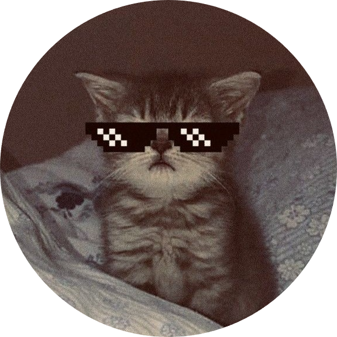

<a id="top"></a>

<div align="center">
  
</div>

<div align="center">
  
  <br><br>
  <a href="https://git.io/typing-svg">
    
  </a>
  <br><br>
  
  
  
  
</div>

<br>

<div align="center">
  <a href="https://www.linkedin.com/in/ramandeep-bhatia-78b792287/"></a>
  <a href="https://ramanbhatiadev.vercel.app/"></a>
  <a href="mailto:bhatia3r@gmail.com"></a>
</div>

<br>

<div align="center">
  <a href="#about"></a>
  <a href="#stack"></a>
  <a href="#projects"></a>
  <a href="#achievements"></a>
  <a href="#research"></a>
  <a href="#analytics"></a>
  <a href="#contact"></a>
</div>

<br>


<a id="about"></a>
## 🌌 Quick Orbit

```text
ramandeep@github ~ $ whoami
> Full Stack Web Developer (MERN) · Final-year CSE student

ramandeep@github ~ $ cat education.txt
> B.Tech CSE, Rayat Bahra Professional University (Aug 2023 → Present)

ramandeep@github ~ $ cat achievements.txt
> 3x runner-up · incl. Snap Syntax @ IIT Roorkee (Cognizance 2026)

ramandeep@github ~ $ cat interests.txt
> Modern UI/UX · scalable web apps · hackathons · competitive coding

ramandeep@github ~ $ ./status
> Open to SWE roles · hackathon teams · open-source projects
```

<div align="center">
  
  
  
  
</div>

<br>

<div align="center">

| 💬 Ask me about | 🎯 Currently focused on | 🎮 Beyond code |
| :-- | :-- | :-- |
| MERN stack apps<br>Tailwind CSS & UI polish<br>Hackathon strategy<br>Competitive coding | Landing a software engineering role<br>Full-stack projects with real users<br>Hackathons & coding contests | Gaming YouTuber<br>Cricket game content |

</div>


<a id="stack"></a>
## 🛠️ Tech Stack

<div align="center">

| | |
| :-- | :-- |
| **Languages** |  |
| **Frontend** |  |
| **Backend** |  |
| **Databases** |  |
| **Tools** |  |

</div>


<a id="projects"></a>
## 🚀 Featured Projects

<div align="center">

| Project | What it does | Stack | Links |
| :-- | :-- | :-- | :-- |
| **CityCare** 🏙️ | Full-stack civic issue reporting platform. Citizens report local problems and track their status. Runner-up at the Full Stack Web Dev Hackathon 2025. | MERN · Tailwind CSS | [Repo](https://github.com/ramanbhatia3) · [Live](https://ramanbhatiadev.vercel.app/) |

</div>

> 💡 More work lives on my [portfolio](https://ramanbhatiadev.vercel.app/).


<a id="achievements"></a>
## 🏆 Hackathons & Achievements

<div align="center">

| Year | Event | Result | Details |
| :-: | :-- | :-: | :-- |
| **2026** | **Snap Syntax**<br><sub>IIT Roorkee · Cognizance 2026</sub> | 🥈 2nd | Premier competitive coding championship. Won cash prizes worth **₹60,000**. |
| **2026** | **Zonals Snap Syntax**<br><sub>Rayat Bahra Professional University</sub> | 🥈 2nd | Campus qualifiers run by IIT Roorkee representatives. Earned a fully sponsored invite to Cognizance 2026. |
| **2025** | **Full Stack Web Dev Hackathon**<br><sub>Rayat Bahra Professional University</sub> | 🥈 2nd | Built and pitched **CityCare**, a full-stack civic issue reporting platform. |

</div>


<a id="analytics"></a>
## 📊 GitHub Analytics

<div align="center">
  
</div>

<br>


<br>


<a id="contact"></a>
## 🤝 Let's Build Something

<div align="center">
  
  <br><br>
  <b>Hiring, forming a hackathon team, or have an idea worth building?</b>
  <br><br>
  <a href="mailto:bhatia3r@gmail.com"></a>
  <a href="https://www.linkedin.com/in/ramandeep-bhatia-78b792287/"></a>
  <a href="https://ramanbhatiadev.vercel.app/"></a>
  <br><br>
  <a href="#top"></a>
</div>


